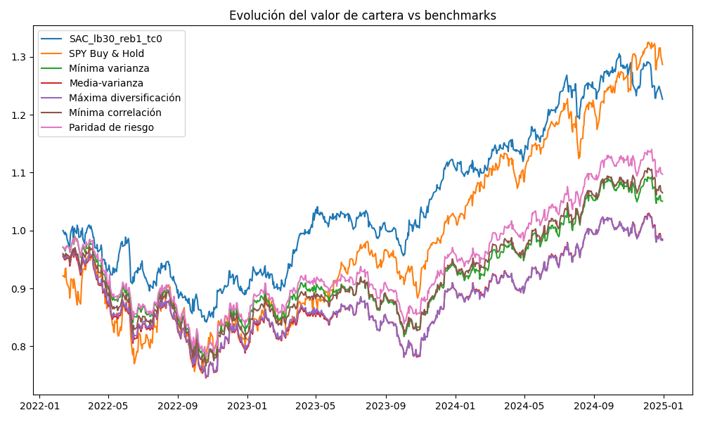

# Dynamic portfolio management with deep reinforcement learning

Bachelor's thesis in Business and Technology, University of Santiago de Compostela (2025). Grade: 9.8/10.

**Question.** Can a deep reinforcement learning (DRL) agent with no prior financial knowledge, trained only on historical data, learn a dynamic asset allocation policy that beats classical portfolio strategies out of sample?

**Short answer.** Only partly. In a frictionless simulation, the selected agent (Soft Actor-Critic) had the highest Sharpe and Sortino ratios and the smallest drawdown of all strategies in the 2022–2024 test, although SPY buy-and-hold ended with a higher final value. But the agent turns over about 30% of the portfolio every day: it behaves like a short-horizon trading policy, not a long-term allocation, and with realistic trading costs its advantage would very likely disappear. Why, and what I would change, is explained below.

The full thesis (in Spanish) is in [`docs/thesis_es.pdf`](docs/thesis_es.pdf).

## What was built

- **Market simulation from scratch** (`src/portfolio_env.py`): a Gymnasium environment where the agent allocates daily between **SPY (US equities), TLT (long-term Treasuries), GLD (gold) and cash**, with portfolio drift, configurable rebalancing frequency and transaction costs.
- **Observations** (`src/observation_builder.py`): rolling windows of prices, technical indicators (`ta`) and macroeconomic series from FRED (CPI, Fed funds rate, US dollar index).
- **Agents**: A2C, PPO, Recurrent PPO, DDPG, TD3 and SAC from Stable-Baselines3, compared under the same conditions.
- **Benchmarks** (`src/benchmarks.py`): SPY buy-and-hold, minimum variance, mean-variance, maximum diversification, minimum correlation and risk parity.
- **Metrics** (`src/metrics.py`): final portfolio value, Sharpe, Sortino, maximum drawdown and turnover.

## Experimental design

1. **Algorithm comparison** with daily and monthly rebalancing.
2. **Sensitivity analysis of SAC** to rebalancing frequency, transaction costs and observation window length.
3. **Out-of-sample test**: training on 2006–2021, evaluation on 2022–2024 against the classical benchmarks.

## Results (out-of-sample test, 2022–2024)

Selected configuration: SAC, 30-day observation window, daily rebalancing, no transaction costs.

| Strategy | Final value | Sharpe | Sortino | Max drawdown | Avg. daily turnover |
| :-- | --: | --: | --: | --: | --: |
| **SAC agent** | 1.23 | **0.65** | **1.03** | **-16.6%** | 30.3% |
| SPY buy-and-hold | **1.29** | 0.57 | 0.81 | -24.5% | 0% |
| Risk parity | 1.10 | 0.33 | 0.52 | -21.9% | 0% |
| Minimum correlation | 1.07 | 0.24 | 0.37 | -23.4% | 0% |
| Minimum variance | 1.05 | 0.20 | 0.32 | -22.8% | 0% |
| Mean-variance | 0.99 | 0.02 | 0.03 | -25.4% | 0% |
| Maximum diversification | 0.98 | 0.01 | 0.02 | -25.2% | 0% |



Other findings from the thesis:
- SAC offered the best balance between Sharpe ratio and drawdown; DDPG and TD3 reached higher final values but with much higher volatility and turnover.
- Less frequent rebalancing lowered the agent's net return, but more reactive policies were very sensitive to transaction costs; longer rebalancing intervals reduced that impact.
- Observation windows longer than 30 days added noise and reduced the consistency of the policy (not conclusive).

## Interpretation: why this is not a production strategy

- **The objective rewards growth, not risk.** The reward is the daily log return of the portfolio net of costs. The agent is therefore pushed to maximise wealth; risk only enters indirectly. The good risk-adjusted metrics are a by-product, not something the agent was asked to deliver. Only this family of rewards was used (an early version used the simple net return); risk-aware alternatives such as the differential Sharpe ratio are discussed in the thesis but were not tested.
- **It trades, it does not allocate.** An average daily turnover of 30% means moving a large part of the portfolio every day. That is the opposite of the long-term asset allocation the project set out to study.
- **The market is too kind.** The headline result uses no transaction costs, and the environment ignores slippage, liquidity constraints and leverage. The sensitivity analysis in the thesis shows that daily policies are very sensitive to costs.
- **Narrow test.** One period (2006–2024), one test window and four assets; results may not hold elsewhere. Computing power (a single laptop) limited the search over hyperparameters and architectures.

## What I would change

- A **risk-aware reward** (for example a differential Sharpe ratio or a drawdown penalty) and an explicit **turnover penalty**.
- **Realistic costs and slippage** in every experiment, and lower rebalancing frequencies.
- **Walk-forward validation** over several test windows instead of a single split.
- A **wider universe** of assets and a cash return equal to the risk-free rate.

## Known issue

In `src/portfolio_env.py` the history field `portfolio_net_returns` stores the gross return. As a result, the Sharpe and Sortino ratios ignore transaction costs when costs are above zero; final value and drawdown are computed net of costs. The headline test above uses zero costs, so it is not affected; the cost-sensitivity figures in the thesis overstate the Sharpe ratio of the runs with costs. The code is left as submitted.

## How to run

```bash
pip install -r requirements.txt
export FRED_API_KEY=your_key          # free key from FRED
python scripts/01_download_data.py    # prices and macro data
python scripts/02_explore_data.py     # exploratory plots
python scripts/03_test_env.py         # sanity check with baseline policies
python scripts/04_train_agent.py      # train an agent
python scripts/05_evaluate_agent.py   # evaluate against the benchmarks
```

Trained models and datasets are not included in the repository because of their size; the scripts regenerate them.

## Repository structure

```
scripts/   01-05: data download, exploration, environment test, training, evaluation
src/       environment, observations, data, metrics, benchmarks, training, plots
docs/      thesis (PDF, Spanish) and figures
```

This repository contains the code as submitted with the thesis in July 2025 (tag `thesis-version`). Code comments are in Spanish.
